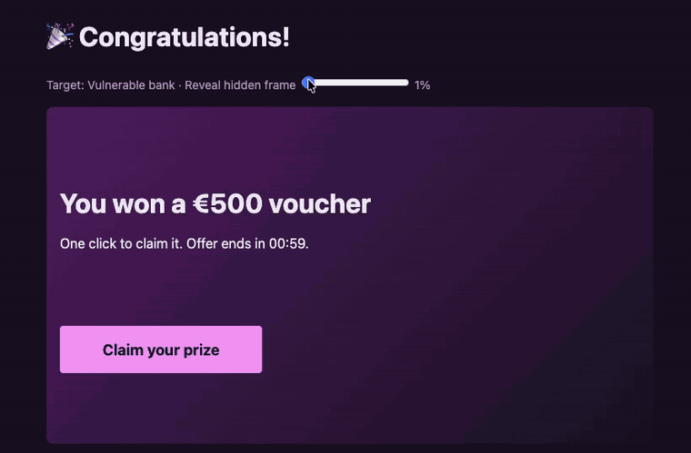

# Twin Bank Security Lab: vulnerable vs hardened, side by side

> ⚠️ **Deliberately vulnerable.** Runs on `127.0.0.1` only. Fake users, fake money, no real secrets.

One TypeScript bank runs twice from the same image: once with a **vulnerable** security profile and once with a **hardened** one. An attacker site fires the same attacks at both, so you can watch each security header and cookie flag do its job, or fail to.



## Why I built this

I hit a wall studying security headers and cookie flags. I made a big stack of flashcards and drilled them, and after a while it became clear what was wrong: I was memorizing the concepts, but I lacked a real understanding of the mechanisms and how they relate to each other.

Then an idea came to mind: what if I ran two copies of one website and introduced slight misconfigurations into one? I wanted a safe (and legal...) way to see these mechanisms work in action, and what their absence does to a system.

So I designed a set of scenarios to watch in action, and wrote up the architecture alongside them. In the spirit of full transparency, the implementation was done with a coding agent (thanks, Claude). The servers are simple by design, minimal versions that exist only to show the mechanisms.

## Requirements and endpoints

Requires only Docker Desktop; Node, npm and TypeScript exist only inside the containers.

| URL                                  | What                                                                            |
| ------------------------------------ | ------------------------------------------------------------------------------- |
| http://bank.localhost:3000           | Bank, **vulnerable** profile                                                    |
| http://bank-safe.localhost:3001      | Bank, **hardened** profile                                                      |
| http://attacker.localhost:4000       | Attacker: attack list + loot panel                                              |
| http://evilbank.localhost:4000       | Attacker persona that passes the vulnerable CORS check                          |
| http://evil.bank-safe.localhost:4000 | Attacker persona that is **same-site** with the hardened bank (CSRF token demo) |

Users: `alice / alice123`, `mallory / mallory123`.

## Running it safely

I don't plan to actively maintain this repository, so treat it as a dated snapshot. Running someone else's code carries inherent risk; full precautions, and how to apply updates, are in [SECURITY.md](SECURITY.md).

The bank is deliberately attackable; the setup around it is not. Most of what keeps this safe to run is already in place, and a couple of things are up to you:

- **Localhost only.** Every port binds to `127.0.0.1`, so the vulnerable app is never reachable from your network. Don't rebind it to `0.0.0.0`.
- **Hardened containers.** Each service runs as a non-root user on a read-only filesystem, with dropped Linux capabilities and strict CPU, memory and process limits.
- **Use a throwaway browser.** Drive the attacks from a separate Chrome profile, not one logged into real accounts. The command is in [SECURITY.md](SECURITY.md).
- **Fake everything.** Demo users, fake money, no real secrets in the repo.

Once you've read [SECURITY.md](SECURITY.md) and checked for stale dependencies, bring the servers up:

```bash
docker compose build
docker compose up
```

## The four findings

| Finding | Attack | Fix |
|---|---|---|
| F-01 | Stored XSS through a CSP that is "present" but has `'unsafe-inline'` | Output encoding + nonce-based CSP + `HttpOnly` |
| F-02 | CORS check `origin.includes('bank.localhost')`, so `evilbank.localhost` can read the account | Exact-match origin allowlist |
| F-03 | Cross-site request forgery on `POST /transfer` | Anti-CSRF token + `SameSite=Lax` |
| F-04 | Clickjacking the "Confirm transfer" page | `frame-ancestors 'none'` + `X-Frame-Options: DENY` |

Each row links to a full write-up in [attack-flows/](attack-flows/), and these are the heart of the project. Each one follows a single finding from reproduction to fix: captured requests and responses from Chrome DevTools and Burp, screenshots of the attack landing and then being blocked, the root cause traced to the exact line in the `vulnerable` profile, a table of what each defensive layer would have stopped, where it applies, a curl check that confirms the fix with no browser needed. Every write-up ends with the hardened bank refusing the same attack.

- **[Stored XSS](attack-flows/XSS.md):** why a CSP can be present and still useless: this one ships `'unsafe-inline'`, so the injected script runs anyway, and why `HttpOnly` stops the cookie theft but not the transfer the script makes as the victim.
- **[CORS misconfiguration](attack-flows/CORS-misconfiguration.md):** how a one-line `origin.includes()` check hands a lookalike domain full read access to the account and the CSRF token.
- **[CSRF](attack-flows/CSRF.md):** why `SameSite=Lax` quietly handles a cross-site attacker but a hostile subdomain still gets through, and what the anti-CSRF token covers that the cookie attribute can't.
- **[Clickjacking](attack-flows/clickjacking.md):** why a valid CSRF token is no defense when the victim clicks the bank's real button through an invisible frame, and the two headers that are.

For step-by-step reproduction of all four, see [ATTACKS.md](ATTACKS.md).

## License

[MIT](LICENSE) © 2026 Natalia Cybulska. Use it, fork it, teach with it, good luck! 
