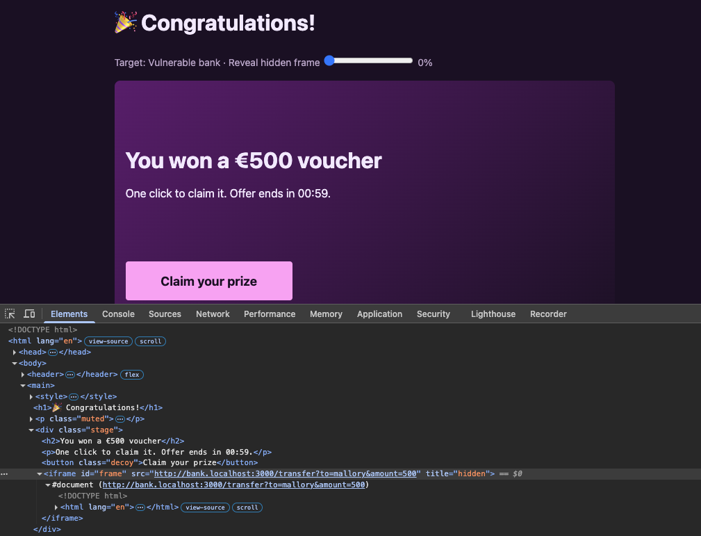
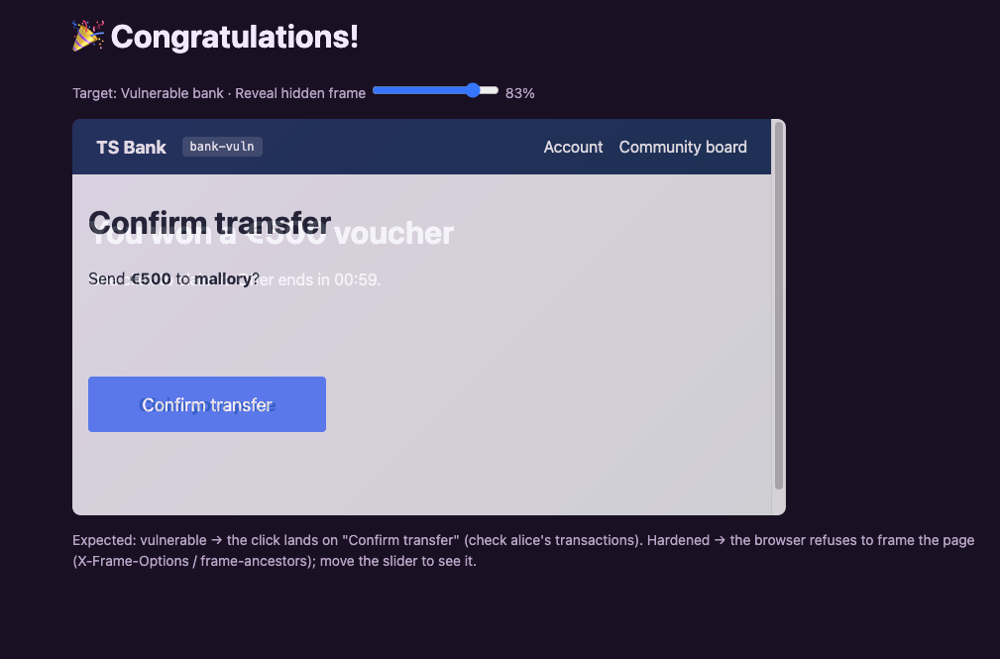
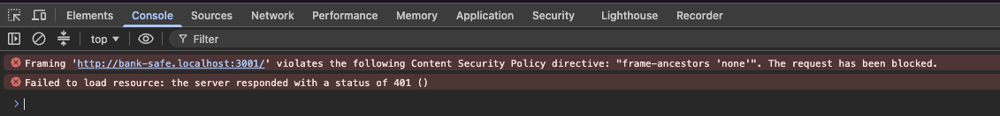

# Clickjacking: a prize button that signs a transfer

After a series of unfortunate events and a good amount of lost money, Alice thought luck was finally on her side. After all, how many times could she fall victim to Mallory? (Spoiler: as many times as she keeps clicking things she shouldn't.) She gets a shiny new email claiming she won a voucher, and opens a site with a "Claim your prize" button. The button is a decoration. Sitting invisibly on top of it is the bank's real "Confirm transfer" page, and her click lands there instead. She moves €500 to Mallory and sees a party emoji for her trouble. The hardened bank refuses to be put in a frame at all. Exact steps to reproduce it are in [ATTACKS.md](../ATTACKS.md).

Setup: Alice is logged in to both banks in a normal Chrome window. The prize page is on the attacker site; it loads the bank inside an invisible iframe.

## Vulnerable bank

### The prize page

The page is mostly theatre. The working parts are an iframe and a decoy button, stacked:

```html
<style>
  .decoy  { position: absolute; left: 16px; top: 260px; width: 240px; height: 56px; }
  .stage iframe { position: absolute; left: 0; top: 0; width: 720px; height: 400px;
                  border: 0; opacity: 0; z-index: 2; }
</style>

<button class="decoy">Claim your prize</button>
<iframe id="frame" src="http://bank.localhost:3000/transfer?to=mallory&amount=500"></iframe>
```

The iframe loads the bank's "Confirm transfer" page, pre-filled with `to=mallory` and `amount=500`. Two CSS properties do the whole trick:

- `opacity: 0` makes the iframe invisible. The bank page is fully there, rendered and clickable.
- `z-index: 2` puts that invisible iframe *above* the decoy button. So the thing Alice sees ("Claim your prize") is underneath, and the thing her cursor actually hits is the bank's "Confirm transfer" button.

The decoy's coordinates aren't guesswork. The bank's confirm button sits at a fixed position in its own stylesheet, and the decoy is placed at the same spot so the two line up exactly. The demo page adds a "Reveal hidden frame" slider that ramps the iframe's opacity from 0, which is the only reason you can see the alignment at all:



Turn the opacity up and the bank's page fades in, perfectly registered over the prize card. The blue "Confirm transfer" button lands exactly where "Claim your prize" was:



### What the click did

Clicking the decoy submits the bank's own confirm form. That fires `POST /transfer`, and the bank redirects to the account page, which loads inside the frame:

```http
GET /account?notice=Sent%20%E2%82%AC500%20to%20mallory HTTP/1.1
Host: bank.localhost:3000
Cookie: sid=7EYkL1DRuwq1nnYZ32aiu9wmrIZxSnOm6sAutJFVuVg
Referer: http://bank.localhost:3000/transfer?to=mallory&amount=500
Sec-Fetch-Dest: iframe
Sec-Fetch-Mode: navigate
Sec-Fetch-Site: same-origin
Sec-Fetch-User: ?1
Upgrade-Insecure-Requests: 1
...
```

`Sec-Fetch-Dest: iframe` is the browser saying this navigation happened inside a frame. `Sec-Fetch-Site: same-origin` because the hop from `/transfer` to `/account` is bank-to-bank; the fact that the whole frame is embedded in a hostile page doesn't change that. The cookie rode along because the vulnerable session cookie is `SameSite=None`, so it's sent even to a bank page embedded under `attacker.localhost`.

The response confirms the money moved:

```http
HTTP/1.1 200 OK
X-Powered-By: Express
Content-Security-Policy: default-src 'self'; script-src 'self' 'unsafe-inline'; style-src 'self' 'unsafe-inline'; img-src * data:
...

...
  <main><h1>Hello, alice</h1>
<p class="notice">Sent €500 to mallory</p>
<section class="card">
  <p class="balance">Balance: <strong>€500</strong></p>
...
  <table>
    <tr><th>Time</th><th>From</th><th>To</th><th>Amount</th></tr>
    <tr><td>2026-11-09T17:09:23.994Z</td><td>alice</td><td>mallory</td><td>€500</td></tr>
  </table>
```

Balance down to €500, one transfer to mallory. Alice, meanwhile, is still looking at "Congratulations!" because the account page that proves it is sitting in an invisible frame.

### Why this isn't just CSRF with extra steps

The request that moved the money was a genuine same-origin POST from the bank's own confirm page, carrying the bank's own valid CSRF token. A CSRF token can't stop this: the token was never the attacker's to forge, because Alice's browser loaded the real form and submitted it. The attacker never saw or needed the token. All he supplied was a convincing reason to click, and a precise place to click it.

That's the thing to hold onto. CSRF tricks the browser into *sending* a request. Clickjacking tricks the *user* into making one, through the real UI. Different defenses stop them.

## Impact

One click, €500, framed as a reward so the victim cooperates. On a real site the target is usually whatever sits one confirmation click away: approving an OAuth consent screen, confirming a payment, deleting an account, toggling a "make my profile public" switch, accepting new permissions. Anywhere a single click is the final authorisation, a transparent frame can harvest that click.

It needs more from the victim than CSRF does (an actual click, in roughly the right place) and the attacker has to line up the overlay, which takes knowing the target page's layout. In exchange it defeats CSRF tokens completely, because the victim drives the real interface. It also scales: the same prize page works for every logged-in visitor, and a `00:59` countdown is there to make people hurry past their instincts.

## What went wrong

### 1. The bank let itself be framed

The root cause is an absence. The vulnerable profile ships no anti-framing headers:

```ts
// vulnerable.ts
frameProtection: false,
```

With that off, the bank sends neither `X-Frame-Options` nor a CSP `frame-ancestors`, so the browser is happy to embed the bank anywhere, including inside an invisible iframe on a hostile page. The hardened profile turns it on, and the middleware emits both:

```ts
// middleware.ts, when frameProtection is true
directives.push("frame-ancestors 'none'"); // modern browsers
res.setHeader('X-Frame-Options', 'DENY');  // legacy fallback
```

`frame-ancestors 'none'` is the modern control and `X-Frame-Options: DENY` covers older browsers that don't read it. Either one tells the browser to refuse the frame.

### 2. The session cookie travels into a third-party frame

`SameSite=None` shows up again. The framed bank page lives inside a top-level page on `attacker.localhost`, so from the browser's view it's a cross-site, third-party context. `SameSite=None` sends Alice's cookie there anyway, which is why she appears logged in inside the frame and the confirm button works. `SameSite=Lax`, the hardened setting, would withhold the cookie, and the framed page would show "Not logged in" with nothing to confirm. So even a bank that forgot its framing headers would get some protection from the cookie attribute alone.

### What each layer would have stopped

| Control | Effect on this attack |
| --- | --- |
| `frame-ancestors 'none'` / `X-Frame-Options: DENY` | Browser refuses to frame the bank; there's nothing to click |
| `SameSite=Lax` cookie | Frame loads but gets no session; the confirm page shows "Not logged in" |
| CSRF token | Nothing. The click submits the bank's own form with its own valid token |
| The vulnerable bank's CSP | Nothing. It never set `frame-ancestors`, which is the directive that matters here |

## Hardened bank

Point the same prize page at `bank-safe.localhost:3001` and move the reveal slider. There's nothing behind the decoy. The console says why:



```
Framing 'http://bank-safe.localhost:3001/' violates the following Content Security
Policy directive: "frame-ancestors 'none'". The request has been blocked.

Failed to load resource: the server responded with a status of 401 ()
```

Two independent things went wrong for the attacker, which is becoming a theme:

- `frame-ancestors 'none'` told the browser to refuse the frame, so even though the response arrived, nothing is rendered or clickable.
- The response was a `401` anyway. `SameSite=Lax` kept Alice's cookie out of the cross-site frame, so the bank saw an anonymous request and declined to show the transfer page at all.

Either one is enough on its own. The attacker needs the bank to be framable *and* the session to be present inside that frame, and the hardened bank denies both.

## Takeaway

Clickjacking is the one attack here that doesn't go through code at all; it goes through the user's eyes and a transparent iframe. That's why the token that stops CSRF does nothing against it: the victim is operating the real form, not being impersonated. The fix is a header that says "don't frame me", with the cookie attribute as a second line if that header is ever forgotten. It's the cheapest fix in the lab, and the easiest to leave off, because a page works perfectly whether or not it refuses to be framed. You only notice it's missing when someone builds a prize wheel on top of it.
