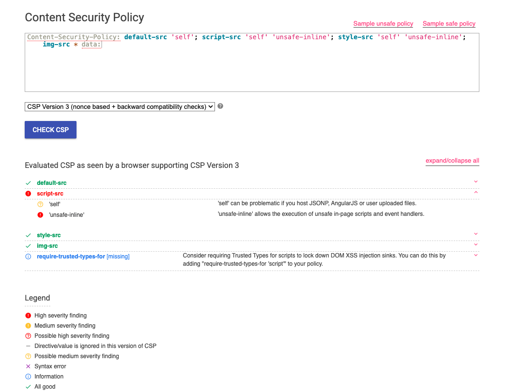
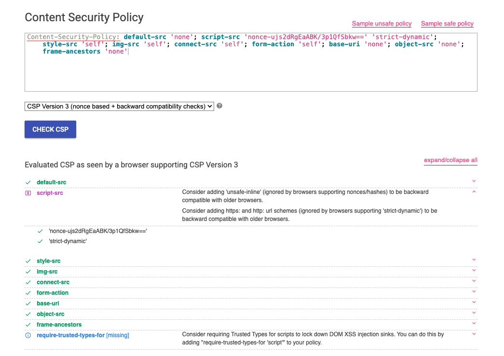

# CSP Evaluator

Google's CSP Evaluator is a web tool with zero setup: paste a `Content-Security-Policy` value, pick the CSP version, and it grades each directive. It answers the question F-01 hinges on (see the [XSS write-up](../attack-flows/XSS.md)): not just whether a CSP header exists, but whether it actually stops anything.

## Vulnerable bank

The policy from the vulnerable profile:

```
Content-Security-Policy: default-src 'self'; script-src 'self' 'unsafe-inline'; style-src 'self' 'unsafe-inline'; img-src * data:
```



The tool goes straight to the problem. `script-src` is marked high severity, and the reason is spelled out: `'unsafe-inline'` allows the execution of unsafe in-page scripts and event handlers. That is the F-01 attack in one line. The header is present, so a shallow "is a CSP set?" check passes, and the one value that matters makes it do nothing against an injected script.

It also flags `'self'` as a possible-high finding (problematic if you host JSONP, AngularJS or user-uploaded files) and notes `require-trusted-types-for` is missing. `default-src`, `style-src` and `img-src` pass. The green tick on `img-src *` is a useful reminder of the tool's scope: it grades script execution and says nothing about the `*` that gives the stolen cookie its way out in the XSS write-up.

## Hardened bank

```
Content-Security-Policy: default-src 'none'; script-src 'nonce-ujs2dRgEaABK/3p1QfSbkw==' 'strict-dynamic'; style-src 'self'; img-src 'self'; connect-src 'self'; form-action 'self'; base-uri 'none'; object-src 'none'; frame-ancestors 'none'
```



Every directive comes back green. The only remarks left are informational:

- two backward-compatibility suggestions on `script-src`: add `'unsafe-inline'` and `https:`/`http:`, which nonce- and strict-dynamic-aware browsers ignore but older ones can fall back to, and
- `require-trusted-types-for` missing, an optional next step for locking down DOM-XSS sinks.

## What it does and doesn't tell you

CSP Evaluator reads the string and never loads the page. It won't catch a CSP that a proxy duplicates or overrides, a header that isn't being sent at all, or the `img-src *` exfiltration path that only matters once a script is already running. For those you still need the browser and the request captures in the attack write-ups. What it does, better than anything else here, is turn "there's a CSP" into "here is the exact value that makes it worthless", which is what F-01 is built around.
